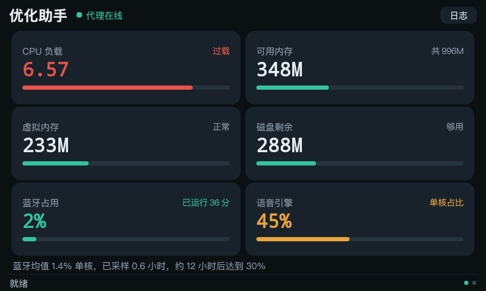
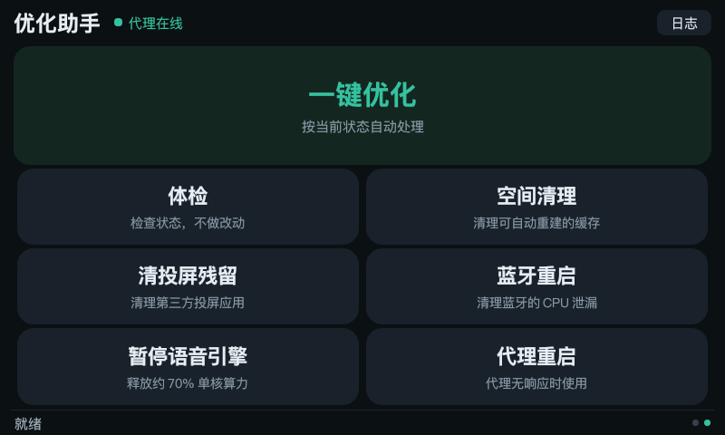
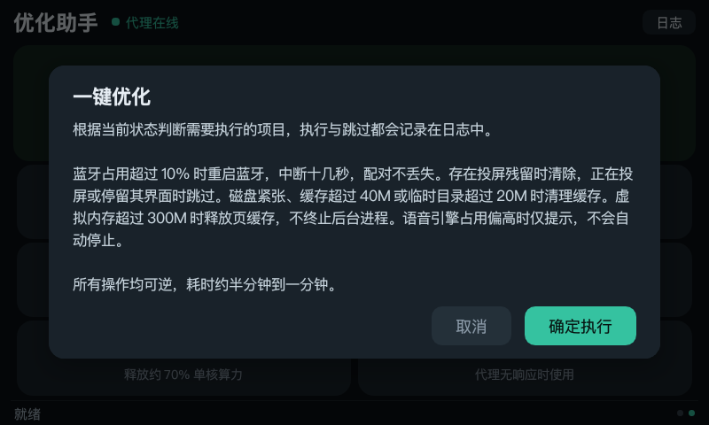

# 小爱触屏音箱优化助手

面向小米小爱触屏音箱 LX04 的设备状态检查与优化工具。在设备屏幕上直接运行，无需连接电脑。



## 它解决什么问题

小爱触屏音箱 LX04 配备 1 GB 内存与 1 GB 用户可用存储，硬件资源相对紧张。设备长时间连续运行之后，系统响应速度下降，桌面渲染出现迟滞，音频播放出现中断。原因通常不在单个应用，而在于若干后台服务的处理器占用随运行时间累积增长，持续挤占本已有限的运算资源。

常规处理方式是重启整机。这种方式虽然有效，但会造成播放中断与智能家居服务短暂不可用，对于需要长期在线的使用场景并不适宜。

优化助手在设备屏幕上呈现各项运行状态，并针对上述占用问题提供单独的处理功能。多数操作无需重启整机，也无需借助电脑。

## 功能

### 状态监测

状态页显示处理器负载、可用内存、虚拟内存、磁盘剩余、蓝牙服务占用和语音引擎占用六项指标。每项配有进度条和颜色标记，绿色表示正常，黄色表示需要留意，红色表示已经超出合理范围。

页面底部根据采样数据给出一句趋势判断，例如蓝牙服务按当前速度还有多久会达到告警线。该判断需要设备运行一段时间之后才准确。

### 蓝牙重启

蓝牙服务在长时间运行后会持续占用越来越多的处理器时间。这属于系统自身行为，既无报错也无提示，用户只能感知到设备响应变慢。

蓝牙重启会重新初始化该服务，将累积的占用清零。过程中蓝牙连接中断十几秒，已经配对过的设备不需要重新配对，也不需要重启整机。

适用于设备长时间运行后响应变慢、蓝牙播放不顺畅或者蓝牙设备反复断连的情况。

### 空间清理

设备的数据分区只有 1 GB，安装几个应用之后往往只剩一百多 MB。空间清理会删除应用缓存、系统日志、崩溃记录、缩略图和临时文件这些删除后会自动重建的内容，不会修改已安装的应用，也不会删除个人文件。

适用于系统提示空间不足或者应用无法更新的情况。

### 清投屏残留

部分投屏应用在退出后将进程驻留在后台继续运行，占用处理器与网络端口。该功能会识别此类进程并终止。

执行前会检查该应用是否处于前台、是否正在投屏，检测到正在使用即跳过，不会打断正在观看的画面。

适用于投屏结束、退回桌面之后清理残留进程。

### 暂停语音引擎

小爱同学的语音处理需要持续占用接近一个核心的处理器时间，这属于正常现象。该开关可在不需要语音交互的时段将其停止，需要时再恢复。

关闭期间唤醒词失效，设备不再响应小爱同学。若日常依赖语音控制，不建议关闭。

### 一键优化与体检

一键优化会按当前状态自动判断需要处理的项目，逐项执行，跳过的项目也会说明原因。适用于不希望逐项判断、仅需恢复设备响应速度的情况。

体检只读取状态，不做任何改动，输出各项指标以及后台占用较多的应用。

### 代理重启

后台服务无响应时使用，重新启动一次即可恢复。日常无需操作。

## 界面

界面共两屏，左右滑动切换。第一屏是各项状态指标，第二屏是功能按钮。



执行操作之前会弹出确认层，写明这次操作会改动什么、有什么影响、能不能恢复。



## 安装

前提是设备已经开启网络调试，电脑与音箱处于同一个局域网，电脑上已安装 adb。

```bash
adb connect 设备地址:5555
adb shell setprop persist.adb.tcp.port 5555
adb install -r apk/lx04-doctor.apk
```

然后在音箱屏幕上打开优化助手，等待几秒，标题栏右侧显示代理在线即可使用。

第二条命令用于保存调试端口，设备重启之后依然有效。执行过这一步，日常使用和设备重启都不再需要电脑。

仓库内的 SKILL.md 供具备命令行能力的智能体使用，由它代为完成上述步骤。

## 使用建议

建议放置于桌面显眼位置，每周查看一次状态页。

蓝牙占用超过 10% 时执行蓝牙重启，超过该数值之后整机的响应速度会开始下降。

磁盘剩余低于 150 MB 时执行空间清理。

处理器负载不能直接等同于处理器使用率，判断时需结合可用内存与虚拟内存。

## 适用范围

| 项目 | 要求 |
| --- | --- |
| 设备型号 | 小米小爱触屏音箱 LX04 |
| 系统版本 | Android 8.1 |
| 系统权限 | 需要 root 权限和可用的网络调试 |
| 应用体积 | 约 30 KB |

其他型号未经验证，请勿使用。

## 许可

本项目采用 MIT 许可证，可以自由使用、修改和分发。使用本工具造成的设备故障或数据损失由使用者自行承担。
